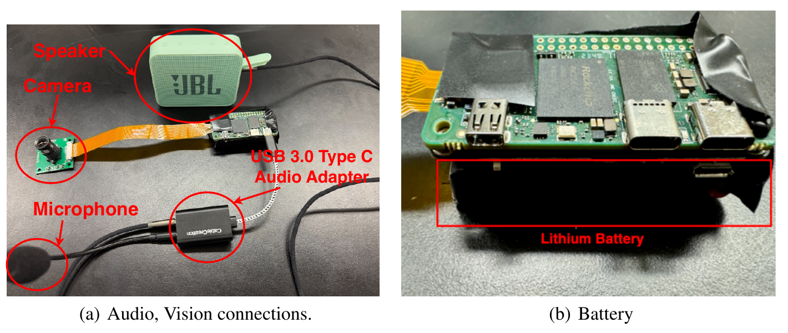
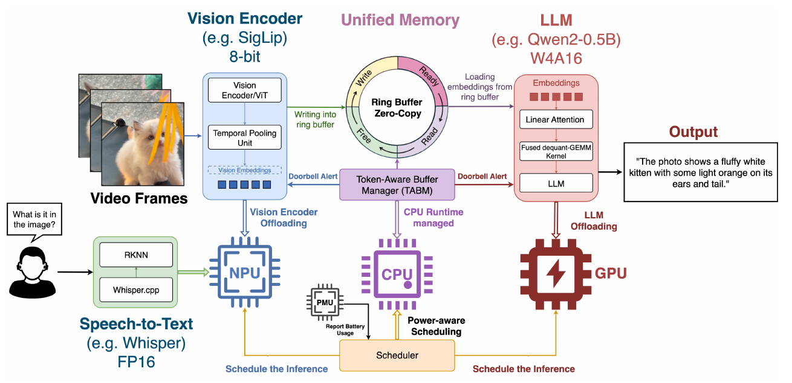

<div align="center">

# NanoMind

### Tiny but Mighty: A Software-Hardware Co-Design Approach for<br>Efficient Multimodal Inference on Battery-Powered Small Devices

**ICLR 2026**

<p>Yilong Li<sup>1</sup>, Shuai Zhang<sup>2</sup>, Yijing Zeng<sup>1</sup>, Chengpo Yan<sup>1</sup>, Hao Zhang<sup>1</sup>,<br>Xinmiao Xiong<sup>1</sup>, Jingyu Liu<sup>1</sup>, Pan Hu<sup>3</sup>, Suman Banerjee<sup>1</sup></p>

<sup>1</sup>University of Wisconsin&ndash;Madison &nbsp; <sup>2</sup>Amazon Web Services AI &nbsp; <sup>3</sup>Uber

<p>
  <a href="https://proceedings.iclr.cc/paper_files/paper/2026/hash/b20260e3e1bd7ea108831925d65ce0a6-Abstract-Conference.html"></a>
  <a href="https://proceedings.iclr.cc/paper_files/paper/2026/file/b20260e3e1bd7ea108831925d65ce0a6-Paper-Conference.pdf"></a>
  <a href="https://arxiv.org/abs/2510.05109"></a>
  <a href="https://github.com/jimmy-yilong-li/CrossInfer"></a>
</p>

**Multimodal intelligence on a small, battery-powered device. Entirely offline.**

</div>

> [!IMPORTANT]
> **NanoMind's latest implementation and code have been merged into [CrossInfer](https://github.com/jimmy-yilong-li/CrossInfer).**
> Visit CrossInfer for the current implementation and ongoing development. This repository retains the NanoMind paper and earlier model assets.

<p align="center">
  
  <br>
  <sub>The NanoMind prototype: camera and audio interfaces alongside a battery-powered compute board. Figure 11 of the ICLR paper.</sub>
</p>

## Overview

NanoMind co-designs software and hardware to run multimodal LLMs on small devices. Rather than execute an entire model on one accelerator, it separates vision, projection, language, and audio into independently executable modules. Each module runs on a suitable compute engine, with shared-memory embedding transfer connecting the stages.

<p align="center">
  
  <br>
  <sub>Module-level heterogeneous execution with zero-copy embedding transfer. Figure 1 of the ICLR paper.</sub>
</p>

### What Makes It Work

| Modular execution | Zero-copy communication | Battery-aware co-design |
| :--- | :--- | :--- |
| Map model components to suitable CPU, GPU, and NPU engines. | TABM coordinates embedding ownership through a shared ring buffer, avoiding intermediate copies. | Combine low-bit kernels, power-aware scheduling, and a compact hardware prototype. |

## Selected Results

<table>
  <tr>
    <th align="center" width="33%">Energy</th>
    <th align="center" width="33%">Latency</th>
    <th align="center" width="33%">Battery Life</th>
  </tr>
  <tr>
    <td align="center"><h2>42.3% lower</h2>End-to-end energy</td>
    <td align="center"><h2>36.2% lower</h2>End-to-end latency</td>
    <td align="center"><h2>18.8 hours</h2>On-demand operation</td>
  </tr>
  <tr>
    <td>Against the edge frameworks and development kits evaluated in the paper.</td>
    <td>Versus Orange Pi 5 Ultra with RKLLM, using 4-bit Qwen2-VL-2B on InfoVQA.</td>
    <td>LLaVA-OneVision-Qwen2-0.5B with a camera and a 2,000 mAh battery, in low-duty-cycle mode.</td>
  </tr>
</table>

These are distinct comparisons from the [ICLR 2026 paper](https://proceedings.iclr.cc/paper_files/paper/2026/file/b20260e3e1bd7ea108831925d65ce0a6-Paper-Conference.pdf), not measurements from a single configuration. Battery life refers to on-demand operation, not continuous inference.

## Code and Resources

- **[CrossInfer](https://github.com/jimmy-yilong-li/CrossInfer)**: the home of the latest implementation and code.
- **[ICLR paper](https://proceedings.iclr.cc/paper_files/paper/2026/file/b20260e3e1bd7ea108831925d65ce0a6-Paper-Conference.pdf)**: system design, hardware prototype, and evaluation.
- **[Earlier model assets](models/)**: the original repository's reference assets, retained here for continuity.

## Citation

```bibtex
@inproceedings{li2026tiny,
  title     = {Tiny but Mighty: A Software-Hardware Co-Design Approach for
               Efficient Multimodal Inference on Battery-Powered Small Devices},
  author    = {Yilong Li and Shuai Zhang and Yijing Zeng and Chengpo Yan and
               Hao Zhang and Xinmiao Xiong and Jingyu Liu and Pan Hu and
               Suman Banerjee},
  booktitle = {The Fourteenth International Conference on Learning Representations},
  year      = {2026},
  url       = {https://proceedings.iclr.cc/paper_files/paper/2026/hash/b20260e3e1bd7ea108831925d65ce0a6-Abstract-Conference.html}
}
```
